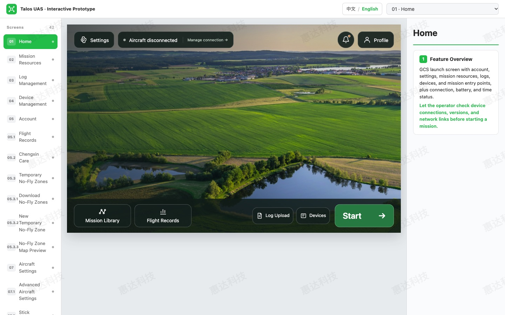

# Home screen update

This change brings the approved Home layout into the original controller prototype. It is the first incremental redesign update; the existing mission workspace, device management, account pages, language switch, and prototype shell retain their current implementations.

## Layout and behavior

- Rounded controls replace the original Home navigation appearance.
- Settings is the first control at the top left.
- Aircraft connection status remains visible at the top. The large Aircraft illustration/card is omitted to keep the field image clear.
- Notifications and Profile sit at the top right. The notification indicator reflects the existing controller storage state; its panel links to Storage when capacity is low.
- Mission Library and Flight Records occupy equal-width, equal-height positions on the bottom bar.
- Log Upload and Devices remain directly accessible beside the green Start button.
- Start opens the existing `flightManual` screen. It does not send an aircraft command.
- English and Chinese labels follow the existing language selector.

## Implementation

`home-screen.js` installs after the selected language bundle is available. It replaces only the registered Home renderer and the shared `homeUI` function used by existing device overlays. A guarded installer attaches one delegated click listener and one keyboard listener to the stable screen root, so repeated Home renders do not accumulate listeners. State remains inside the module except for the existing navigation and device state APIs.

Buttons are native buttons with explicit types. Icons are decorative SVGs with fixed paths; visible text supplies each action's name. Notifications expose their expanded state and dialog label, support Escape to close, and return focus to the notification button. Keyboard focus receives a visible outline. The notification panel is nonmodal, so background navigation remains available.

`home-screen.css` scopes the new styles to the Home component. Shared navigation styles, flight screen assets, and other screen renderers are not rewritten. The existing 960 × 600 canvas and responsive scaling are retained. The existing background asset is reused; no dependencies, remote fonts, API keys, or build tooling are added.

## Verification

Browser checks in Chromium covered:

- All eight navigation actions: Settings, aircraft connection, Profile, Mission Library, Flight Records, Log Upload, Devices, and Start.
- Notification opening and Escape dismissal.
- Equal planning-button dimensions within one CSS pixel, allowing for browser subpixel scaling.
- Absence of the large Aircraft card.
- Home control bounds at 1440 × 900 and 1024 × 768 viewports.
- English and Chinese Home rendering.
- No JavaScript runtime exceptions during these checks.

JavaScript syntax checks and `git diff --check` passed. The screenshot was captured from this branch, not from the broader redesign project.

## Limits and rollback

Connection status and aircraft operations remain prototype behavior; this update introduces no live hardware integration. Global shell redesign, dark mode, Mapbox, mission-screen changes, and the proposed firmware-update flow are separate work. The original shell's branding/watermark is retained by this focused update.

To undo the update after merging, revert its commit. The `original-ui` tag also preserves the pre-redesign baseline.
